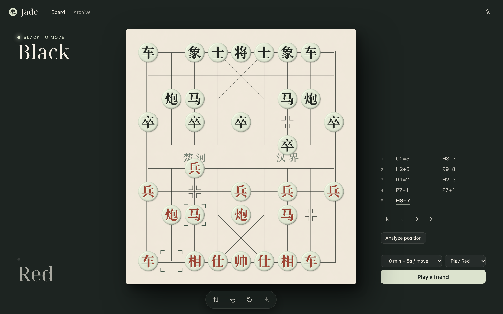

<p align="center">
  
</p>

<h1 align="center">Jade</h1>

<p align="center">A beautiful place to play and explore Xiangqi.<br>玉枰象棋</p>



Jade is Xiangqi (Chinese chess) played on a board that feels like an object: pale jade pieces on a lit table, quiet controls, and nothing between you and the game.

## What you can do

- **Play a friend.** Send a link; they join from their browser.
- **Play on one device.** Pass-and-play works offline. The macOS app can also play against a built-in engine.
- **Replay and study.** Step through a game and try another line without losing the original.
- **Explore games.** Browse a small sample collection with player search and recorded continuations.

Games are private by default. Sharing a game, or letting it be used for research or training, needs both players' consent.

## Status

Jade is in early development. The web app and the macOS app run from source. The iOS, iPadOS, Android, Windows and Linux clients build in CI and are not released yet.

## Run it

With [mise](https://mise.jdx.dev) installed:

```sh
mise install && pnpm install
./dev/build-wasm.sh
cargo run -p jade-match-server   # needed for invitations
pnpm --dir apps/web dev          # http://localhost:3000
```

On a Mac, `./dev/run-macos.sh` opens the native app.

## Learn more

- [Development](docs/development.md): tools, tests and the repository layout
- [Architecture](docs/architecture.md): the shared Rust core and each client
- [Rendering](docs/rendering.md): board geometry, art and accessibility
- [Rules](docs/rules/program-2023.11-v1.md): the rules Jade adjudicates
- [Licensing](docs/licensing.md)

## License

Jade's reusable Rust crates and public protocol are licensed under Apache-2.0. The apps, brand assets, fonts and engine artifacts carry their own terms; see [docs/licensing.md](docs/licensing.md).
