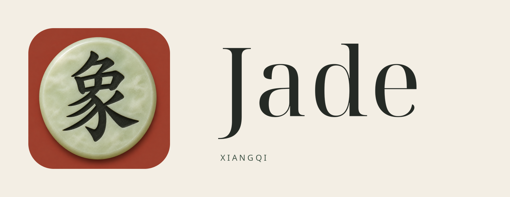

<p align="center">
  
</p>

# Jade — Xiangqi · 玉枰象棋

Jade is a public place to play and explore Xiangqi (Chinese chess), built around a tactile pale-jade board, deterministic rules adjudication, inspectable historical records, and original Rust engine research.

## Product Principles

- **Make the ordinary game excellent.** Board legibility, input, sound, clocks, reconnection, offline play, and replay receive first-class craft.
- **Let the material carry the atmosphere.** Pale jade (`#DCE3CE`), honey boxwood, warm ivory stone, recessed vermilion (`#A54837`) and charcoal (`#252A25`) engraving, and warm paper (`#F3EEE4`) / dark (`#1D2421`) surfaces.
- **Platform-native interfaces over a shared Rust core.** Web (`Nuxt 4 / Vue 3 / TypeScript`), iOS/iPadOS (`SwiftUI + UIKit + Core Graphics`), Android (`Kotlin + Jetpack Compose`), macOS (`SwiftUI + AppKit + Core Graphics`), Windows (`C# + WinUI 3 + Win2D`), and Linux (`Rust + GTK 4 + libadwaita + Cairo`) share one deterministic rules, notation, and geometry core.
- **Make historical evidence inspectable.** Player aliases, recorded continuations, outcomes, and engine evaluations retain explicit provenance.
- **Standalone public checkout.** Everything in `play-jade/jade` resolves dependencies, builds, tests, plays offline, runs a locally hosted match, and explores sample archive fixtures without private credentials, private repositories, or upstream source-site access.
- **Independent regional presentation.** Interface language (`en-US`, `en-GB`, `zh-Hans-CN`, `zh-Hant-TW`, `zh-Hant-HK`), piece-face script (`simplified` / `traditional`), board material, move notation, orientation, sound, and reduced motion are independent settings.

## Repository Layout (`play-jade/jade`)

| Path | Responsibility |
| :--- | :--- |
| `crates/xiangqi-core/` | Deterministic coordinates (`0..8 × 0..9`), legal moves, Chinese/WXF/ICCS/UCI notation, `PositionKey` v1, Section 4 `BoardView` geometry, and `program-2023.11-v1` terminal adjudication (`Apache-2.0`). |
| `crates/archive-client/`, `protocol/`, `data/fixtures/` | Versioned public archive/game/study/privacy contracts, standalone sample fixture provider, and shared rules/geometry fixtures (`Apache-2.0`). |
| `crates/core-wasm/`, `crates/core-ffi/` | `wasm-bindgen` browser module, `UniFFI` Swift/Kotlin bindings, and panic-safe C ABI for Windows `.NET LibraryImport` (`Apache-2.0`). |
| `crates/inference/`, `models/releases/` | Observation/action encoding (`from * 90 + to` = `8,100` labels) and released-model inference contracts (`Apache-2.0`). |
| `crates/match-server/`, `db/game/` | Authoritative `Axum`/`Tokio` match, invitation, `10+5`/untimed clock, reconnection, and private-by-default study service with SQLx migrations. |
| `engines/` | Search adapter contracts, supervised desktop UCI host (`engines/uci-host`), linked C/C++ mobile bridge (`engines/mobile-bridge`), and browser Web Worker (`engines/wasm-worker`). |
| `crates/asset-pipeline/`, `assets/` | Reproducible Rust vector glyph extraction, orthographic 2.5D baked material pipeline, synthesized piece acoustics, brand kit (`assets/brand/`), and `assets/manifest.json`. |
| `apps/web/` | Server-rendered Nuxt 4 / Vue 3 / TypeScript web interface with Canvas 2D materials, SVG/DOM WCAG 2.2 semantics, IndexedDB offline play, and Web Worker analysis. |
| `packages/apple/`, `apps/macos/`, `apps/ios/` | Shared Swift/UniFFI package, native macOS (`SwiftUI + AppKit`), and native iPhone/iPad (`SwiftUI + UIKit`) applications with Core Graphics rendering. |
| `apps/android/` | Native `Kotlin + Jetpack Compose` application with `UniFFI` Kotlin bindings, explicit Compose accessibility semantics, and `SoundPool` audio. |
| `apps/windows/` | Native `C# + WinUI 3 + Win2D` application using `.NET LibraryImport` + `SafeHandle` over `core-ffi`. |
| `apps/linux/` | Native `Rust + GTK 4 + libadwaita + Cairo` application linking `xiangqi-core` directly. |
| `docs/`, `dev/` | Architecture, rules (`program-2023.11-v1`), rendering contract (`docs/rendering.md`), visual reference gallery, licensing, and local build tasks. |

Data acquisition, historical entity resolution, corpus indexing, the hosted archive API, and `Rust/Burn` self-play training live in the private companion repository (`play-jade/cinnabar`), which consumes versioned crates from `play-jade/jade` across a strict one-way dependency boundary.

## Quick Start (Standalone Public Checkout)

1. **Test the Rust rules core, notation, geometry, and server crates**:
   ```sh
   cargo test --workspace
   ```
2. **Verify and rebuild deterministic board art, glyph outlines, and audio manifests**:
   ```sh
   cargo run --release -p jade-asset-pipeline -- --verify
   ```
3. **Build native UCI and linked mobile engine bridges**:
   ```sh
   ./dev/build-engines.sh
   ```
4. **Start the local authoritative match server (`http://127.0.0.1:4180`)**:
   ```sh
   cargo run -p jade-match-server
   ```
5. **Start the Nuxt 4 web application (`http://127.0.0.1:3000`)**:
   ```sh
   pnpm --dir apps/web dev
   ```
6. **Build and launch the native macOS demo (`SwiftUI + AppKit + Core Graphics + C++26 Engine`)**:
   ```sh
   ./dev/run-macos.sh
   ```

## Rules and Privacy Defaults

- **Online rules profile**: `program-2023.11-v1` (Pikafish community *Chinese Chess Program Competition Rules*, rev. 22 November 2023), documented in [`docs/rules/program-2023.11-v1.md`](docs/rules/program-2023.11-v1.md).
- **Clock presets**: Friendly default `10 minutes + 5 seconds/move`, rapid/blitz presets, and untimed play.
- **Privacy**: Personal games and studies are **private by default**. Sharing (`unlisted` / `public`) and opt-ins for internal model training, published research, and downloadable datasets are independent controls requiring both participants' explicit consent for matches.

## Licensing

Reusable public Rust core, binding, interface, and contract crates (`crates/xiangqi-core`, `crates/archive-client`, `crates/inference`, `crates/core-wasm`, `crates/core-ffi`, `engines/uci-host`, and `protocol/`) are licensed under **Apache License 2.0**. Brand assets, SIL Open Font License 1.1 font sources, generated materials, and external engine artifacts carry separate terms documented in [`docs/licensing.md`](docs/licensing.md) and [`assets/brand/README.md`](assets/brand/README.md).
