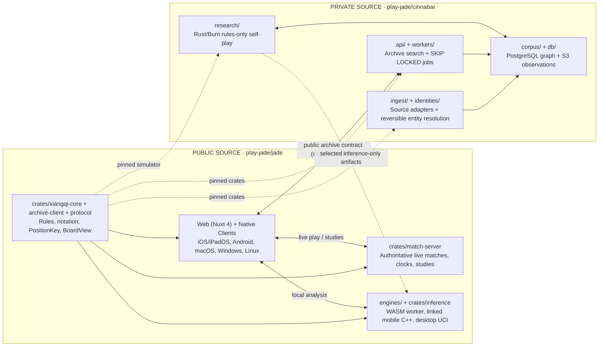

# Jade Public Architecture Summary

`play-jade/jade` is the standalone public repository for the Jade Xiangqi platform. It owns the deterministic rules core, versioned public contracts, authoritative live-match server, sample archive provider, engine host adapters, reproducible art/sound pipeline, web application, and native client applications.

## 1. Public vs. Private Source Boundary

### Boundary Invariants

1. **Standalone public build**: `play-jade/jade` contains zero private path/Git dependencies and requires zero private credentials. When no hosted archive endpoint is configured, clients and `match-server` serve labeled sample fixtures from `crates/archive-client` and `data/fixtures/archive/`. Each successful answer of the archive browse contract (`ArchiveProvider` in `crates/archive-client`) names its dataset release (`ArchiveRelease`); the older player, game, and position endpoints keep their earlier shapes. The web's archive provider (`useArchiveProvider`) reads a configured hosted archive (`NUXT_PUBLIC_ARCHIVE_SOURCE=hosted`) only through its same-origin `/api/archive` routes, which keep the archive's base URL (`NUXT_ARCHIVE_API_URL`) in server configuration. A hosted archive that does not answer is reported as `archive_provider_unavailable`, never replaced with sample records. The archive directory (`/archive`), each game's route (`/archive/g/<game id>`), and player pages read through that provider; a game's route keeps one variation per game and release on the device.
2. **No upstream crawling on request paths**: Public search, player, replay, and continuation endpoints read stored records only and never fetch from upstream external sites.
3. **Separate match vs. offline authority**: Hosted online matches (including untimed online matches) use one server-authoritative ordered command stream per match. Native and browser offline games, saved drafts, and downloaded replays execute locally against `xiangqi-core` without overwriting hosted match state.

## 2. Client and Core Integration Matrix

| Target | UI Framework | Board Renderer | Core Binding | Local Engine Host |
| :--- | :--- | :--- | :--- | :--- |
| **Web** (`apps/web/`) | Nuxt 4, Vue 3, TypeScript (SSR HTML) | Canvas 2D materials + SVG/DOM markings & WCAG 2.2 semantics | `wasm-bindgen` (`crates/core-wasm`) | Web Worker WASM (`engines/wasm-worker`) |
| **iOS / iPadOS** (`apps/ios/`) | SwiftUI + UIKit | Core Graphics + native animation & VoiceOver accessibility elements | `UniFFI` Swift (`packages/apple`) | Linked C/C++ library (`engines/mobile-bridge`) |
| **Android** (`apps/android/`) | Kotlin + Jetpack Compose | Compose `Canvas`/`DrawScope` + explicit `semantics` tree | `UniFFI` Kotlin (`crates/core-ffi`) | Linked C/C++ NDK/JNI (`engines/mobile-bridge`) |
| **macOS** (`apps/macos/`) | SwiftUI + AppKit | Core Graphics in `NSView` + VoiceOver accessibility elements | `UniFFI` Swift (`packages/apple`) | Supervised UCI child process / linked C++ |
| **Windows** (`apps/windows/`) | C# + WinUI 3 / XAML | Win2D `CanvasControl` + UI Automation / Narrator peers | Panic-safe C ABI + `.NET LibraryImport` / `SafeHandle` | Supervised UCI child process |
| **Linux** (`apps/linux/`) | Rust + GTK 4 + libadwaita | `GtkDrawingArea` / Cairo + GTK Accessible roles | Direct Rust crate (`xiangqi-core`) | Supervised UCI child process (`engines/uci-host`) |

## 3. Rules, Storage, Authentication, and Privacy

- **Rules Core (`program-2023.11-v1`)**: `crates/xiangqi-core` implements canonical coordinates (`x=0..8`, `y=0..9`), legal move generation, Chinese/WXF/ICCS/UCI notation, `PositionKey` v1 (`SHA-256` + canonical placement bytes, excluding internal piece tokens), and full `program-2023.11-v1` terminal adjudication (checkmate, `困毙` no-legal-move loss, insufficient attacking material, 39-example verified perpetual check/chase hierarchy, and 120-halfmove check-adjusted natural limit).
- **Authoritative Match Protocol**: Moves submit `{ type: "move", protocol: 1, match_id, command_id, expected_seq, move: { from, to } }`. The server resolves actor identity from session/seat credentials, deduplicates `command_id`, checks sequence and monotonic clock admission, validates via `xiangqi-core`, and commits event + projection atomically in SQLx (`PostgreSQL` in production; `SQLite` supported for zero-setup local public development).
- **Match state dimensions**: Each match's stored state is described by separate counters, each with one job. A write that changes one commits in the same transaction as the event and match state it describes, on SQLite and PostgreSQL alike:
  - *Event sequence* (`current_seq`, a command's `expected_seq`): the count of committed match events. A **new** command made against another sequence is refused; a retry of a committed command is answered before the sequence is compared.
  - *Command identity* (`command_id`): an ID already committed for the match is a retry, answered with the current snapshot and never applied twice. An empty ID or one containing NUL is refused before the lookup; a new command's ID is 1 to 128 bytes, and an ID committed before that limit still retries.
  - *State version* (`state_version`): advances with every stored change to the match (a seat, a move, the clocks, an outcome, either participant's privacy save, a rematch link). Within one match, a client replaces the snapshot it shows only with one of a newer version; the same version again can only bring the running clock down. A snapshot of another match (a rematch) starts its own order, and a server that sends no version is ordered by event sequence.
  - *Turn generation* (`turn_generation`): advances only when a new turn begins: play starting, or a move or an accepted takeback after which play goes on (a game-ending move begins none). When a client receives a later snapshot, it keeps a turn's clocks running down only while the generation is unchanged and otherwise takes the snapshot's clocks, so a takeback and the move replacing it are timed as a new turn even if the client missed both.
  - *Choice revisions* (`red_choices_revision`, `black_choices_revision`): each participant's own privacy and consent choices. A save names the revision it was made against and applies only if that is still current; an accepted save advances only the saving participant's revision, by exactly one, even when the value saved is unchanged.
- **Match server ownership**: one match server owns a database. A file-backed SQLite database is owned through a file lock beside it; an in-memory SQLite database belongs to its process and has no lock file. On PostgreSQL the owner holds an advisory lock and advances an owner epoch (`match_server_owner.epoch`) when it starts; every write of match state first checks that epoch, so a server that lost its lock session commits no match state once a newer owner has started. Writes outside match state, such as creating a guest, are not fenced.
- **Authentication**: Secure `HttpOnly` cookies with CSRF token verification and Origin validation on web; short-lived access tokens + revocable per-install refresh tokens stored in OS credential stores (Apple Keychain, Android Keystore-encrypted storage, Windows Credential Manager, Linux Secret Service keyring) on native clients.
- **Privacy & Consent**: Personal games and studies default to `private`. Sharing (`unlisted` / `public`) and separate consent flags (`allow_internal_training`, `allow_published_research`, `allow_dataset_release`) require both participants' agreement on matches.
